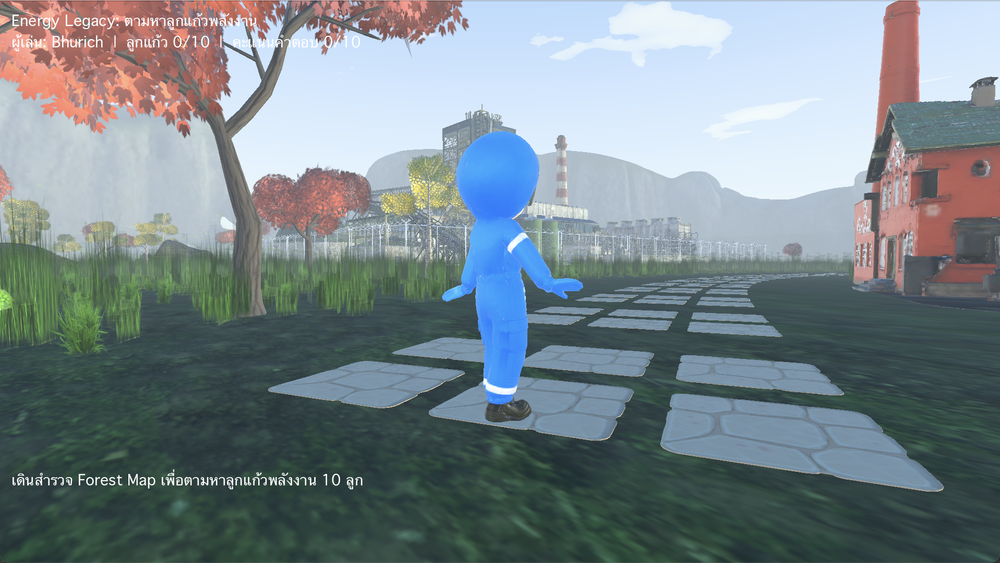
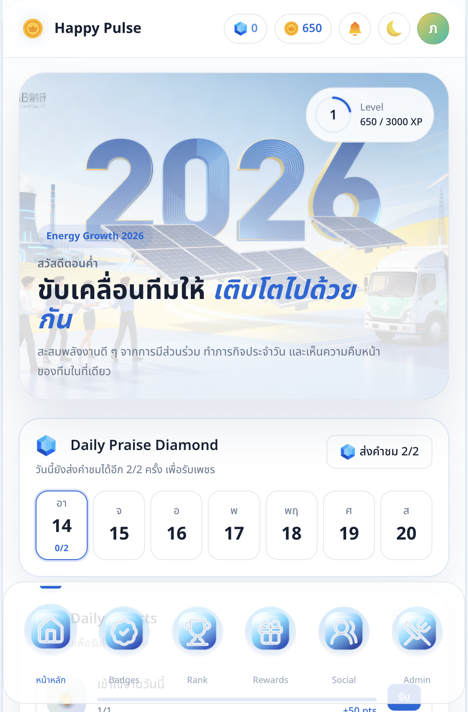
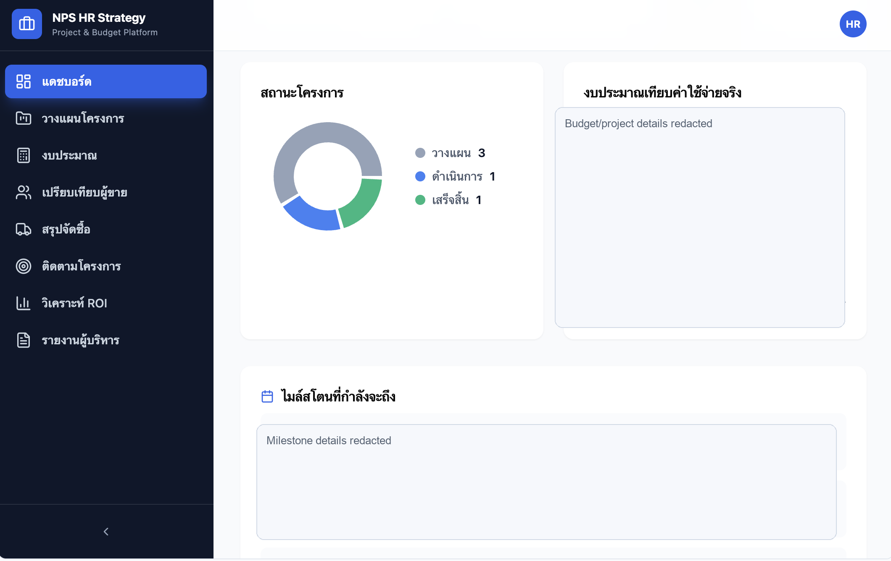
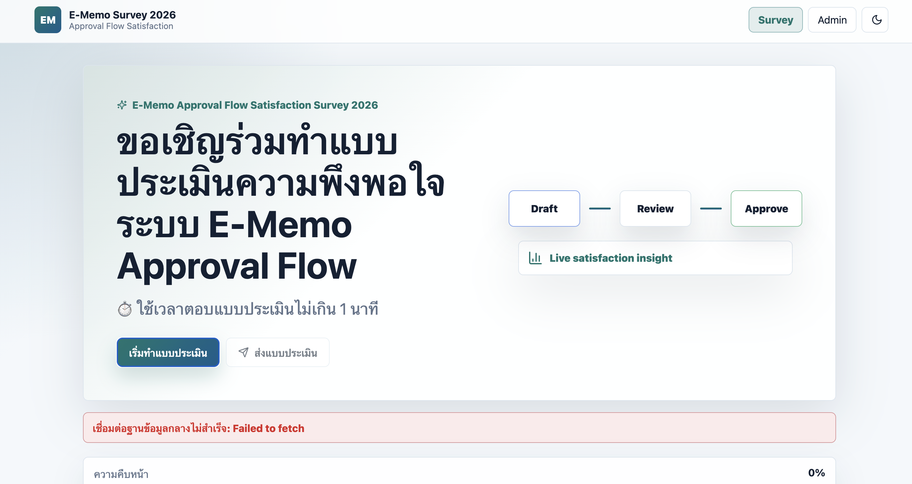
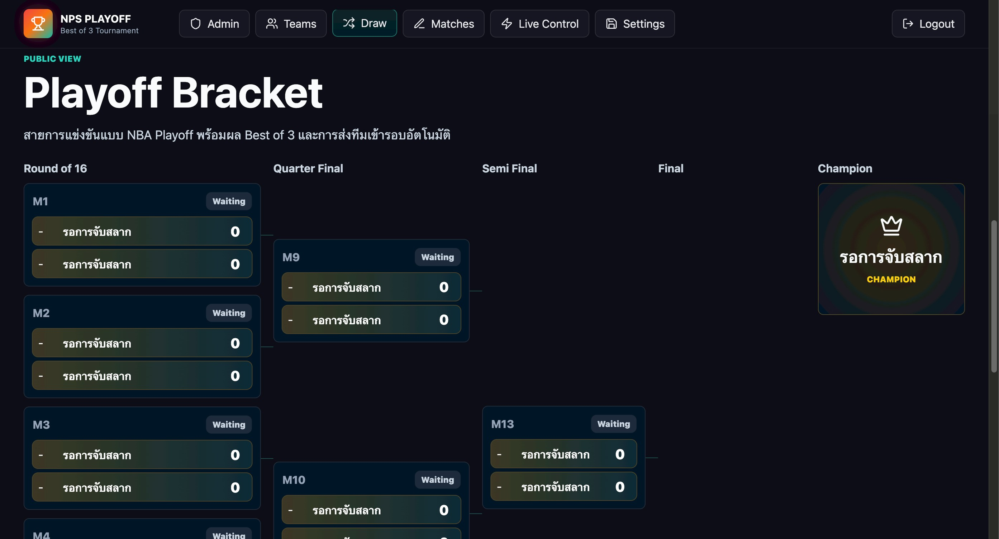

# Bhurich Srichiraphath — AI Transformation Portfolio

I build practical internal systems that help organisations work faster, communicate better, and reduce repetitive manual work.

[▶ เปิดหน้าผลงานจาก AI สำหรับผู้เรียน](ai-work-showcase-th.md)

My background is in HR Strategy & Project work, but my strongest direction is not traditional HR operations. I focus on AI adoption, workflow redesign, productivity systems, gamification, dashboards, and lightweight internal tools.

This portfolio collects selected projects that show how I turn ideas into usable systems.

## Positioning

- AI-driven business operations builder
- Workflow automation and productivity systems thinker
- Cross-functional transformation professional
- Internal tools and rapid prototyping enthusiast
- Practical problem solver who uses AI to move from idea to working system

## Featured Projects

| Project | Theme | What It Shows |
|---|---|---|
| [Energy Legacy: NPS Journey](case-studies/nps-city-godot.md) | Game-based learning simulation | Godot 3D exploration, energy-orb collection, quiz checkpoints, score tracking, and company learning |
| [Songkran Splash Squad](case-studies/songkran-splash-squad.md) | Gamified engagement + event workflow | Live Base44 app with online blessing, splash interaction, bingo, score tracking, admin, and participation mechanics |
| [Happy Pulse HRMS Engagement Platform](case-studies/happy-pulse-hrms-engagement.md) | HRMS-connected engagement app | Passport login, daily praise, mood check-in, rewards, badges, ranking, social feed, and admin configuration |
| [HR Operations Dashboard & People Directory](case-studies/hr-operations-dashboard.md) | HR operations + people data platform | Project/budget dashboard, procurement, ROI, executive reports, people directory, filters, AI import, and export |
| [E-Memo Satisfaction Survey 2026](case-studies/e-memo-satisfaction-survey.md) | Survey + analytics workflow | Approval-flow satisfaction survey, admin dashboard, data export, visual analytics, and Supabase-ready structure |
| [ROV Match Center](case-studies/rov-match-center.md) | Event operations system | Playoff bracket, live match page, tournament dashboard, live scoring, teams, schedules, and admin flow |
| [HR KPI Workshop Operating System](case-studies/hr-kpi-workshop-blueprint.md) | Organisation effectiveness + KPI workshop | Confidential workshop app for pain points, SMART KPI design, action plans, group answers, dashboard, and admin workflow |
| [NPS PulseLift](case-studies/nps-pulselift.md) | Employee engagement + people insight | Engagement app, gamification, dashboards, AI-style insight summaries |
| [KPI Management Platform](case-studies/kpi-management-platform.md) | Performance workflow | KPI creation, tracking, visibility, and manager follow-up |
| [MissionHub](case-studies/missionhub.md) | Internal activity operating system | Missions, employee login, activity tracking, admin controls |
| [Personal AI Agent Stack](case-studies/personal-ai-agent-stack.md) | AI productivity system | AI operating manual, daily command center, prioritisation prompts |
| [AI Simulation Designer Kit](case-studies/ai-simulation-designer-kit.md) | Decision support | Scenario simulation, failure modes, persona simulation, next experiments |

## Visual Portfolio Highlights

### Energy Legacy: NPS Journey

### Songkran Splash Squad

### Happy Pulse HRMS Engagement Platform

### HR Operations Dashboard

### E-Memo Approval Flow Satisfaction Survey

### NPS ROV Match Center

## Project Case Studies

- [Energy Legacy: NPS Journey](case-studies/nps-city-godot.md)
- [Songkran Splash Squad](case-studies/songkran-splash-squad.md)
- [Happy Pulse HRMS Engagement Platform](case-studies/happy-pulse-hrms-engagement.md)
- [HR Operations Dashboard & People Directory](case-studies/hr-operations-dashboard.md)
- [E-Memo Satisfaction Survey 2026](case-studies/e-memo-satisfaction-survey.md)
- [ROV Match Center](case-studies/rov-match-center.md)
- [HR KPI Workshop Operating System](case-studies/hr-kpi-workshop-blueprint.md)
- [NPS PulseLift](case-studies/nps-pulselift.md)
- [KPI Management Platform](case-studies/kpi-management-platform.md)
- [MissionHub](case-studies/missionhub.md)
- [Personal AI Agent Stack](case-studies/personal-ai-agent-stack.md)
- [AI Simulation Designer Kit](case-studies/ai-simulation-designer-kit.md)

## Skills Demonstrated

- AI-assisted development
- Workflow redesign
- Internal tool prototyping
- Dashboard and data visibility
- Gamification for adoption
- Employee experience design
- Organisation effectiveness
- Productivity system design
- Cross-functional problem solving
- Documentation and demo packaging

## How To Read This Portfolio

Each case study follows the same structure:

1. Business problem
2. What I built
3. My role
4. Tools and approach
5. What the project proves
6. Relevance to Organisation & AI Transformation work

## Best Fit Roles

- Organisation & AI Transformation Specialist
- AI Operations
- Digital Transformation
- AI Workflow Specialist
- Product Operations
- AI Productivity / Automation
- Internal Tools / Business Operations
