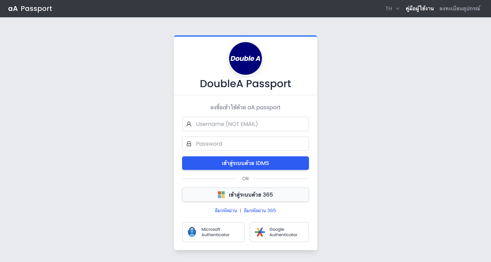
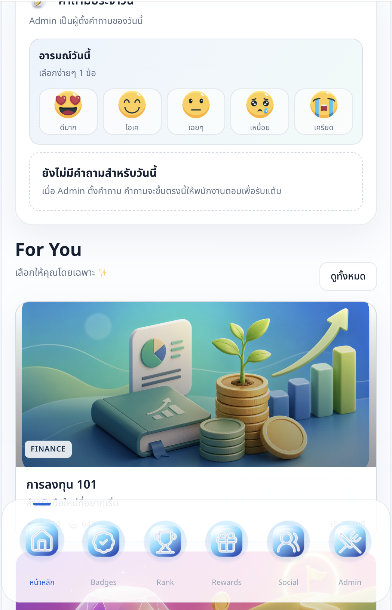
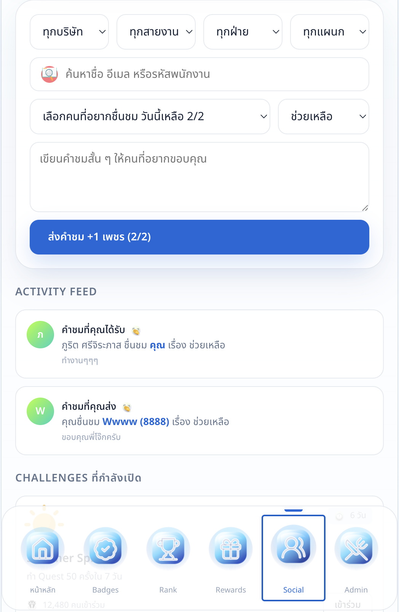

# Happy Pulse HRMS Engagement Platform

## One-Line Pitch

Employee engagement application concept connected to HRMS/Passport account login, combining daily praise, mood check-ins, rewards, badges, ranking, social recognition, learning content, and admin configuration.

## Screenshots

### HRMS / Passport Login

### Employee Home Dashboard

### Mood Check-In and Learning Content

### Social Praise Flow

## Business Problem

Employee engagement can become fragmented when recognition, feedback, rewards, communication, and participation are spread across separate tools. Employees need a simple place to participate, while HR/admin teams need visibility and configuration control.

## What I Built

- HRMS/Passport-style account login concept
- Microsoft 365 login option and authenticator support concept
- Employee home dashboard
- XP, points, badges, ranking, and reward mechanics
- Daily praise flow with limited daily usage
- Mood check-in and admin-configured daily questions
- Learning/content recommendation section
- Social praise activity feed
- Admin navigation and configuration area

## My Role

Product concept, engagement system design, user journey design, gamification design, HRMS integration thinking, interface direction, prototype planning, and AI-assisted build support.

## What This Proves

- I can design employee-facing systems that feel like real internal products.
- I understand how account integration affects adoption and trust.
- I can combine HR engagement, recognition, rewards, learning, social interaction, and admin control into one coherent workflow.
- I think about both employee experience and back-office operating needs.
- I can use gamification mechanics to support participation, not just decoration.

## Relevance To AI Transformation

This project supports Smart Company transformation because it shows how people systems can be redesigned around integrated identity, simple participation, measurable engagement, and configurable workflows that teams can actually operate.

