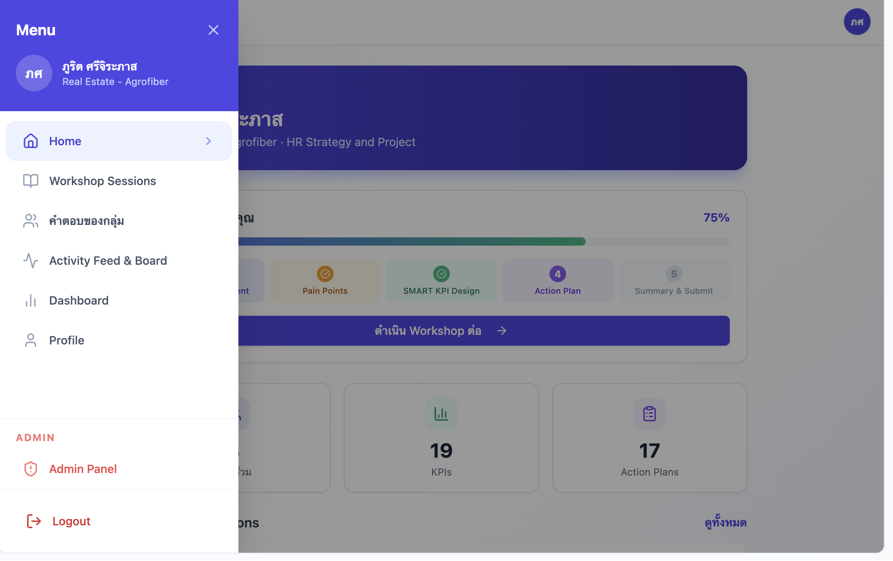

# HR KPI Workshop Operating System

Confidential project. Public link intentionally omitted.

## One-Line Pitch

HR KPI workshop operating system designed to help teams clarify goals, identify pain points, design SMART KPIs, create action plans, and structure performance follow-up in one guided workflow.

## Business Problem

KPI work often becomes difficult when teams do not share the same understanding of outcomes, ownership, measurement, and follow-up. A workshop can help, but the real value comes when workshop progress, group answers, KPI outputs, dashboards, and action plans are captured in a repeatable system.

## What I Built

- Guided workshop session flow
- Progress tracking across workshop stages
- Pain point discovery workflow
- SMART KPI design step
- Action plan creation step
- Summary and submission flow
- Group answer collection
- Activity feed and board
- Dashboard for KPI/action plan visibility
- Profile and role context
- Admin panel for workshop operation

## My Role

Workshop concept, performance workflow thinking, structure design, organisation effectiveness framing, product flow design, and practical implementation planning.

## What This Proves

- I can support organisation effectiveness work, not only engagement activities.
- I understand the connection between business goals, roles, ownership, and performance expectations.
- I can create structured workshop systems for complex people and organisation topics.
- I can turn a workshop into a repeatable operating system with admin control, progress tracking, and output capture.
- I can design tools that help leaders move from discussion to action.

## Relevance To AI Transformation

Smart Company work requires clear outcomes and accountability before tools or AI can improve productivity. This project shows my ability to structure performance conversations and turn them into scalable operating workflows.

