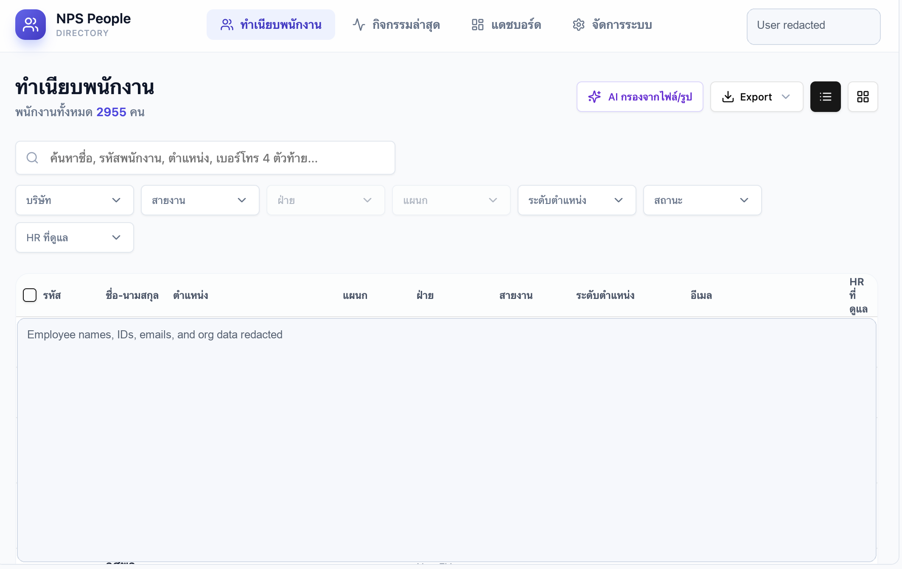

# HR Operations Dashboard & People Directory

Confidential project. Public link intentionally omitted. Screenshots are redacted to protect employee and business data.

## One-Line Pitch

Internal HR operations platform designed to help HR Strategy and team members track projects, budgets, procurement, ROI, executive reports, employee directory data, and HRMS-related people information in one working system.

## Screenshots

### Project & Budget Platform

### People Directory With AI Filtering

## Business Problem

HR project work often lives across spreadsheets, chats, files, manual follow-ups, and separate employee data sources. This makes it harder to see project status, budget usage, vendor comparisons, milestones, people information, and team workload in one place.

## What I Built

- HR Strategy project and budget dashboard
- Project planning section
- Budget tracking and budget-vs-actual view
- Vendor comparison workflow
- Procurement summary
- Project follow-up and milestone tracking
- ROI analysis section
- Executive reporting section
- HR people directory with employee search and filters
- Filters by company, business line, division, department, position level, status, and HR owner
- AI filtering/import concept from files or images
- Export function and list/grid views

## My Role

Product concept, HR workflow mapping, dashboard structure, data model thinking, user journey design, AI-assisted prototyping, interface direction, and practical implementation planning.

## What This Proves

- I can build systems that support real HR operations, not only engagement activities.
- I understand project tracking, budget visibility, procurement flow, ROI thinking, and executive reporting.
- I can turn fragmented HR work into a single operating workspace.
- I can design searchable people systems that support HR teams in daily work.
- I think about AI-assisted data intake and filtering as a productivity layer for HR operations.

## Relevance To AI Transformation

This project fits directly with Smart Company work: reducing manual coordination, improving visibility, using AI to support data handling, and creating practical systems that help HR and business teams operate smarter.

