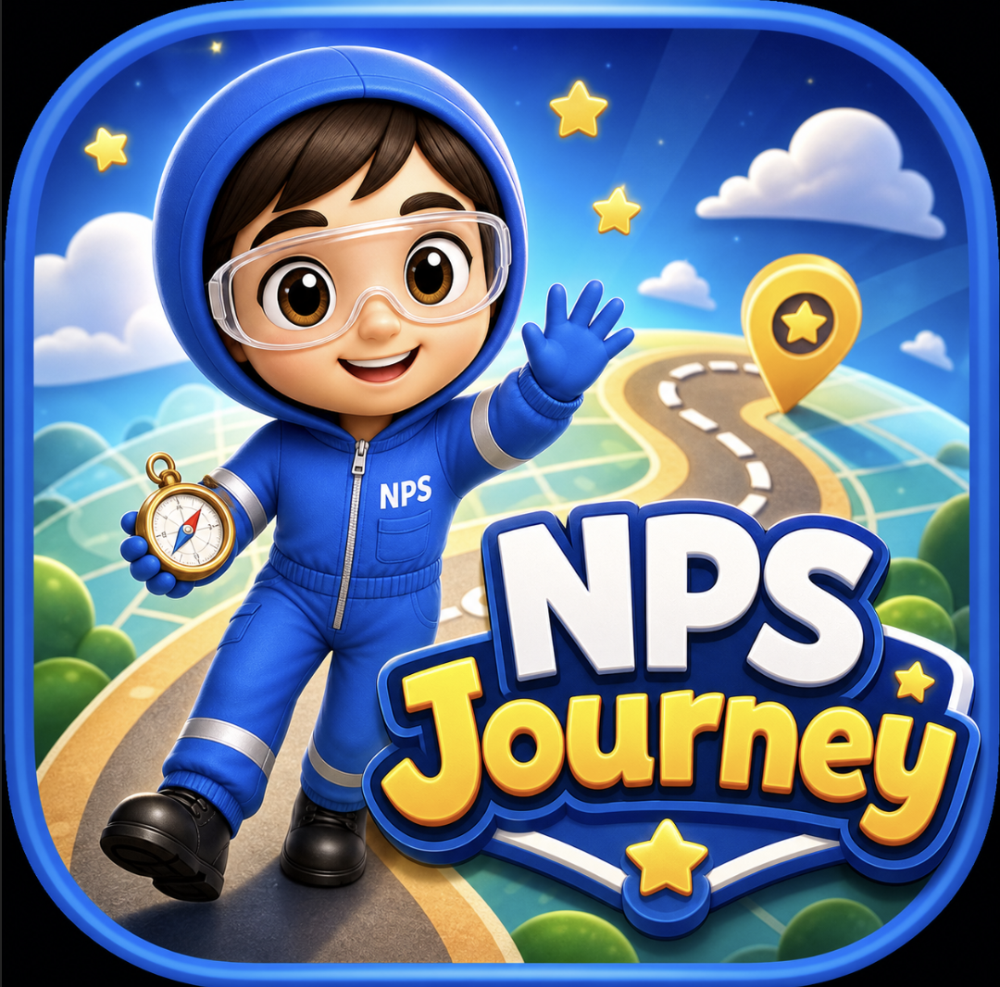
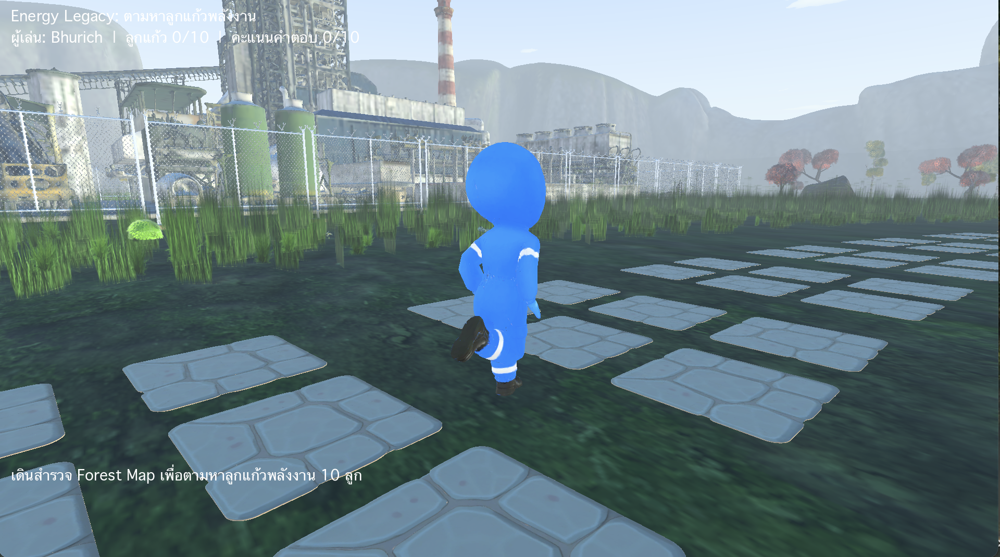
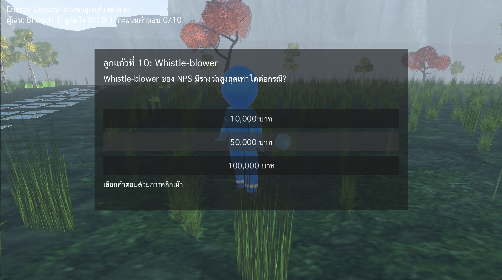
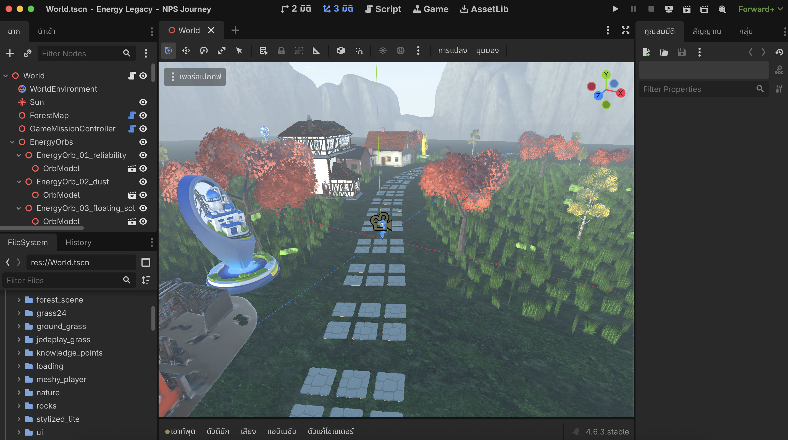

# Energy Legacy: NPS Journey

## One-Line Pitch

3D game-based learning simulation built in Godot to help employees explore company knowledge through movement, energy-orb collection, quiz checkpoints, and interactive discovery.

## Download & Play

[**Download NPS Journey on itch.io — Windows / macOS**](https://bhurich.itch.io/nps-journey-energy-legacy)

Open the itch.io page, scroll to **Download**, and choose `NPS_Journey_Windows.zip` for Windows or `NPS_Journey_Mac.zip` for macOS.

## Screenshots

### App / Game Identity

### Gameplay: Forest Map Exploration

### Gameplay: Energy Orb Collection

### Learning Quiz Overlay

### Godot Development Environment

## Business Problem

Company learning can become passive when employees only receive documents, slides, or one-way training. A game-based learning simulation can make knowledge discovery more memorable by turning company information into exploration, missions, and interactive questions.

## What I Built

- Godot 4.6 prototype
- 3D forest map learning environment
- Player exploration and movement
- Energy orb collection objective
- Quiz checkpoint system
- Score and progress tracking
- Company/energy-themed scene design
- App identity artwork and game presentation
- World scene structure, nodes, assets, and mission controller logic

## My Role

Game concept, learning experience design, prototype direction, world-building, interaction logic, quiz flow design, AI-assisted development, visual direction, and documentation.

## What This Proves

- I can use game engines to create practical learning experiences.
- I can turn company knowledge into interactive missions and quiz checkpoints.
- I understand gamification beyond points and badges: exploration, collection, feedback, score, and progression.
- I can work with 3D environments, scene structure, assets, and gameplay logic.
- I can create a visible prototype that communicates a new way of learning inside an organisation.

## Relevance To AI Transformation

Capability building is a core part of transformation. This project shows how learning can become practical, interactive, and easier to adopt by combining simulation, gamification, and AI-assisted prototyping.

