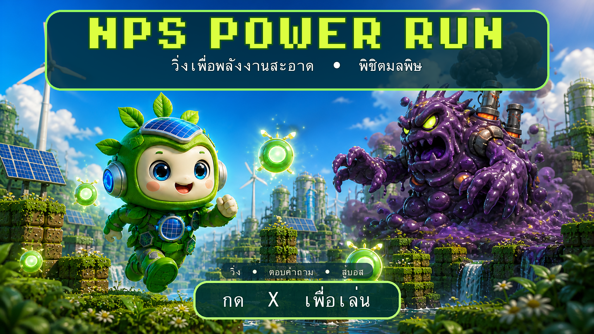
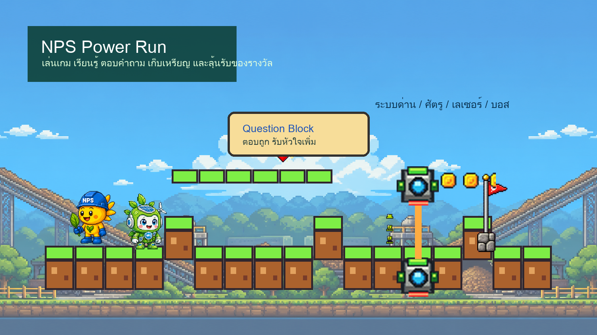
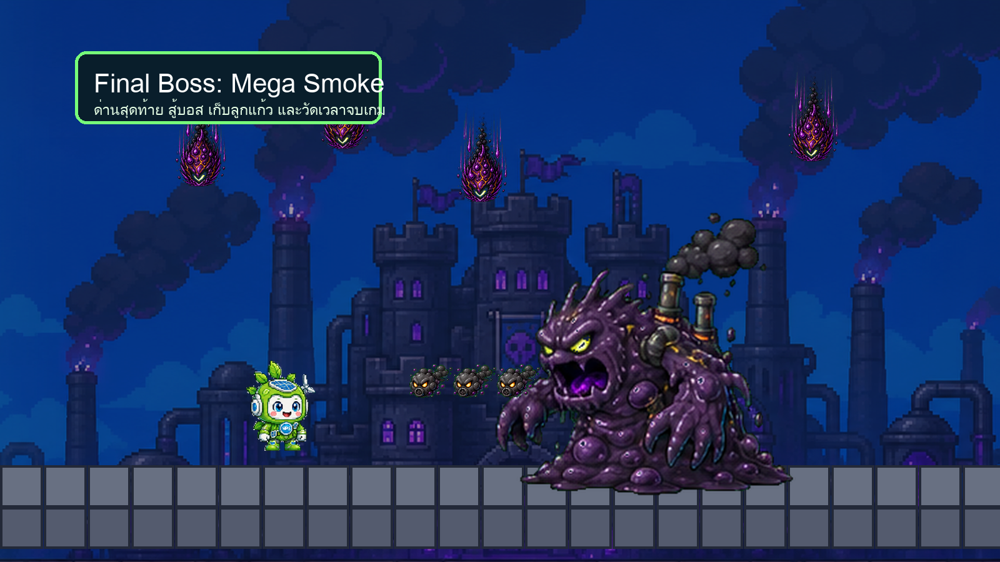

# NPS Power Run

Live project: https://nps-power-run-2026.netlify.app/

## One-Line Pitch

Browser-based 2D learning game built in Godot that turns clean-energy and company knowledge into a three-stage platform adventure with quizzes, collectibles, hazards, and a final pollution boss.

## Gameplay

## Final Boss

## Business Problem

Traditional internal communication can struggle to hold attention when employees receive company or sustainability information only through announcements and presentation materials. The opportunity was to create an experience that made learning active, memorable, and rewarding while remaining easy to access through a web browser.

## What I Built

- A complete 2D platform game in Godot, exported for browser play
- Three progressively themed stages with platforming, hazards, checkpoints, and level transitions
- Fifteen question blocks that connect gameplay with company and clean-energy knowledge
- A custom Greenergy player character, Sunny NPC, collectibles, hearts, coins, and power-ups
- Interactive obstacles including moving and falling platforms, laser gates, enemies, and environmental hazards
- A final Mega Smoke boss encounter with attack patterns, health tracking, retry flow, and ending sequence
- Employee-code entry, run timing, score submission, and a Netlify Functions-backed score dashboard
- Responsive web packaging and a public Netlify deployment for easy campaign access

## My Role

Project concept, learning and gameplay design, Godot development, level flow, quiz integration, character and visual direction, web export, deployment packaging, score workflow, testing, and iteration.

## What This Proves

- I can take an employee-engagement idea from concept to a playable, publicly accessible product.
- I can combine learning objectives with platform-game mechanics instead of presenting knowledge as a passive quiz.
- I can work across game design, Godot scene logic, UI, web deployment, and lightweight backend integration.
- I can design a campaign experience with a clear player journey: enter, explore, answer, collect, progress, defeat the boss, and submit a result.
- I can use AI-assisted development to accelerate prototyping while retaining ownership of the project flow, content, testing, and delivery.

## Relevance To HR Strategy & Project Work

NPS Power Run demonstrates end-to-end project ownership: translating an engagement objective into a creative concept, defining the player journey and content, coordinating campaign requirements, building the digital experience, preparing deployment, and supporting participation with measurable run data.

