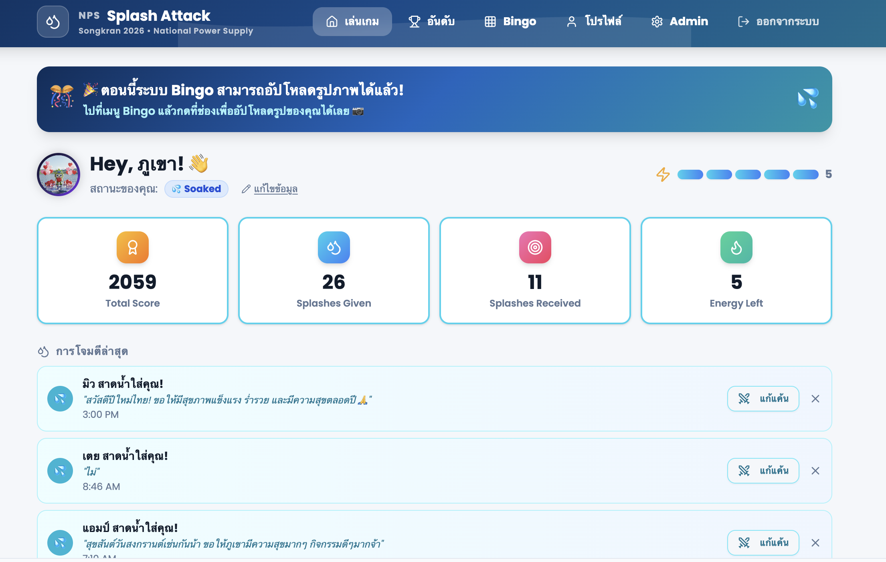

# Songkran Splash Squad

Live project: https://nps-songkran-splash-squad.base44.app

## One-Line Pitch

Online Songkran engagement game that combines virtual water splashing, blessing messages, bingo-style participation, and score collection into one interactive employee experience.

## Business Problem

Internal seasonal events can lose energy when they are handled only through announcements, posters, or one-way communication. The challenge is to make participation easy, playful, trackable, and accessible to employees through a digital experience.

## What I Built

- Virtual Songkran splash interaction
- Blessing/message sending experience
- Bingo-style engagement mechanic
- Score collection and participation tracking concept
- Online event experience that employees can join without complex setup
- Player profile and status system
- Ranking/leaderboard navigation
- Admin area for event operation
- Splash activity feed showing recent interactions
- Energy mechanic to limit actions and make gameplay feel intentional

## My Role

Concept design, gamification flow, employee experience design, prototype direction, AI-assisted build support, and event-to-system thinking.

## What This Proves

- I can turn an internal event into a digital participation system.
- I understand gamification as an adoption tool, not only entertainment.
- I can design lightweight experiences that make employees want to interact.
- I can connect culture, engagement, participation, and tracking in one workflow.
- I can use game mechanics such as score, energy, bingo, ranking, and social interaction to support real adoption.

## Relevance To AI Transformation

This project shows how I redesign employee participation around a practical digital system. It supports the same transformation mindset: make the workflow simpler, more engaging, easier to adopt, and more measurable.
